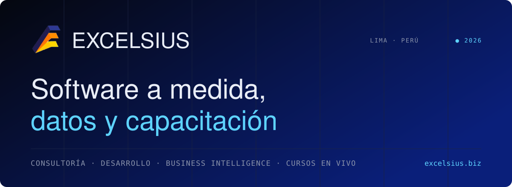
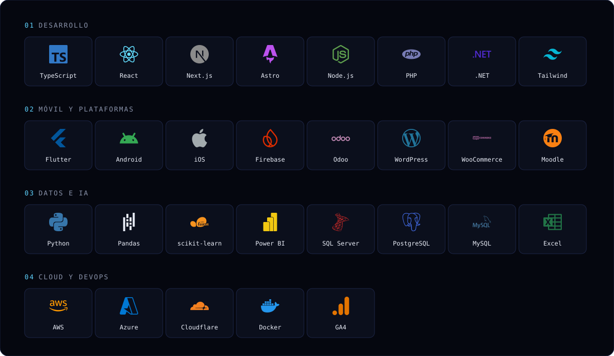

<a href="https://www.excelsius.biz">
  <picture>
    <source media="(prefers-color-scheme: dark)" srcset="https://raw.githubusercontent.com/EXCELSIUS-TI/.github/main/profile/assets/banner-dark.svg">
    <source media="(prefers-color-scheme: light)" srcset="https://raw.githubusercontent.com/EXCELSIUS-TI/.github/main/profile/assets/banner-light.svg">
    
  </picture>
</a>

  
  
  
  
  
  

<code>00</code> &nbsp;CONSULTORÍA, DESARROLLO E IMPLEMENTACIÓN DE TECNOLOGÍAS DE LA INFORMACIÓN

**Excelsius** es una empresa peruana de tecnología con sede en Lima. Construimos **software a medida que llega a producción** — sistemas web, apps móviles, ERP Odoo, Business Intelligence y Machine Learning — y formamos profesionales con **cursos en vivo y certificados** en datos, marketing y seguridad.

 

<code>01</code> &nbsp;SERVICIOS · DIAGNÓSTICO · IMPLEMENTACIÓN · ACOMPAÑAMIENTO

| | Servicio | Qué entregamos |
|:-:|---|---|
| 💻 | [**Software a medida**](https://www.excelsius.biz/servicios/#software) | Sistemas web, CRM, ERP e intranets construidos sobre el proceso real de la empresa, no sobre una plantilla. |
| 📱 | [**Aplicaciones móviles**](https://www.excelsius.biz/servicios/#moviles) | Apps iOS y Android, nativas o híbridas, conectadas al mismo backend que ya usa tu operación. |
| 🌐 | [**Diseño web y CMS**](https://www.excelsius.biz/servicios/#web) | Sitios rápidos, medibles y editables por tu equipo, pensados para convertir y no solo para verse bien. |
| 📊 | [**Business Intelligence**](https://www.excelsius.biz/servicios/#bi) | Del dato disperso al tablero que se mira todas las mañanas: modelo, métricas y gobierno de la información. |
| 🤖 | [**Machine Learning e IA**](https://www.excelsius.biz/servicios/#ml) | Modelos que responden preguntas del negocio: qué se va a vender, quién se va a ir, qué conviene priorizar. |
| 🧩 | [**ERP Odoo**](https://www.excelsius.biz/servicios/#odoo) | Odoo configurado, migrado y adoptado: ventas, compras, inventario, contabilidad y facturación electrónica. |

 

<code>02</code> &nbsp;STACK DE TRABAJO

<picture>
  <source media="(prefers-color-scheme: dark)" srcset="https://raw.githubusercontent.com/EXCELSIUS-TI/.github/main/profile/assets/stack-dark.svg">
  <source media="(prefers-color-scheme: light)" srcset="https://raw.githubusercontent.com/EXCELSIUS-TI/.github/main/profile/assets/stack-light.svg">
  
</picture>

 

<code>03</code> &nbsp;CURSOS · TALLERES · ESPECIALIDADES — <a href="https://www.excelsius.biz/cursos/">ver catálogo</a>

| Área | Cursos en vivo con certificación |
|---|---|
| **Gestión y análisis de datos** | [Power BI con IA para Analítica Avanzada](https://www.excelsius.biz/cursos/power-bi-con-ia-para-analitica-avanzada/) · [Python para Análisis de Datos](https://www.excelsius.biz/cursos/python-para-analisis-de-datos/) · [Análisis de Datos con SQL Server e IA](https://www.excelsius.biz/cursos/analisis-de-datos-con-sql-server-e-ia/) |
| **Marketing y comunicaciones** | [Plan de Marketing 2027 con IA](https://www.excelsius.biz/cursos/plan-de-marketing-2027-con-ia/) · [Marketing Digital, Estrategia de Redes y Optimización con IA](https://www.excelsius.biz/cursos/marketing-digital-estrategia-de-redes-y-optimizacion-con-ia/) |
| **Seguridad y gestión ambiental** | [Supervisor SSOMA](https://www.excelsius.biz/cursos/supervisor-ssoma/) · [Capacitaciones SST in house](https://www.excelsius.biz/curso-sst-1/) |

 

<code>04</code> &nbsp;CONTACTO

📍 Calle Alameda del Arcoíris 118, Santiago de Surco, Lima, Perú &nbsp;·&nbsp; 📞 [+51 951 753 920](https://wa.link/m0gsz9) &nbsp;·&nbsp; ✉️ [informes@excelsius.biz](mailto:informes@excelsius.biz)
 
🕘 Lun a vie · 9:00 a. m. – 7:00 p. m. &nbsp;·&nbsp; Clases en vivo de 7:30 a 10:30 p. m.

<a href="https://www.excelsius.biz/blog/">Blog</a> · <a href="https://www.excelsius.biz/nosotros/">Nosotros</a> · <a href="https://www.excelsius.biz/contacto/">Contacto</a>

